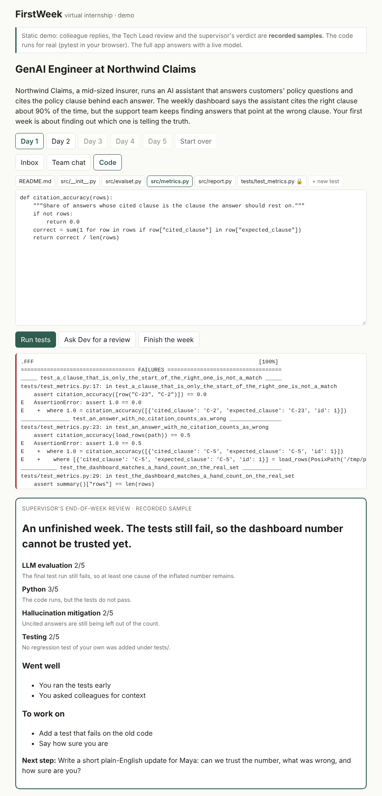

# FirstWeek

**Live your first week in a new AI role.** Type any job title, such as GenAI Engineer or Agentic AI Engineer, and FirstWeek shows what the job really involves, backed by evidence from real job postings and practitioner sources. Then you do the job: a five-day simulated project with tickets, a codebase, and AI colleagues (a Tech Lead who reviews your pull requests, a PM who changes priorities mid-week) who react to your work. You leave with a portfolio repo and a skill matrix where every score links to evidence.

> Status: **portfolio version finished (November 2026).** What works: the live demo and video, three complete practice projects with a five-day internship each, the research pipeline and evidence-checked Role Reality Reports, and a real code sandbox. Generating new projects automatically is experimental (see [below](#generated-projects-experimental)).

## Try it (free demo)

[45-second walkthrough video](docs/img/firstweek-demo.mp4) · [live demo](https://rushitpatel100-oss.github.io/FirstWeek/)

The [demo page](apps/demo) is a static site: a week at a made-up insurer, with a team chat, tickets
arriving day by day, and a real Python project you edit and test. The tests run for real in your
browser (pytest through Pyodide). Colleague replies, the code review and the end-of-week verdict
are recorded samples; the full app answers with a live model. See [ADR 0025](docs/adr/0025-static-portfolio-demo.md).
Run it locally: `cd apps/demo && pnpm install && pnpm dev`.



## Why

New AI roles are hard to understand from the outside. Career switchers can learn the tools, but cannot see what the work looks like day to day, so their projects often miss what employers need. FirstWeek makes these roles visible, then lets people try them.

## How it works

| Layer | What you get |
| --- | --- |
| **Discover** | A Role Reality Report: responsibilities, tools and pain points, built from real UK job postings and practitioner sources. Every claim cites its sources, is checked by a model from another family, and carries a confidence level. |
| **Experience** | A five-day virtual internship at a made-up company: colleagues message you in character, work arrives day by day (a manager's message, a complaint, a ticket, a meeting), and you fix a real Python codebase whose tests run in a sandbox. |
| **Review** | A Tech Lead reviews your code, and your supervisor writes an end-of-week review. Both work offline with stock replies when the free model quota runs out. |

Accuracy comes from evidence, not model memory: job postings are de-duplicated and counted, every report sentence is checked against the passages it cites, and the three "golden" roles (GenAI Engineer, Agentic AI Engineer, AI Software Engineer) each have a hand-written practice project, reviewed by a person, with planted issues and a reference solution.

## Generated projects (experimental)

`make autopilot role="..."` tries to design and build a new practice project with free models: a hosted model plans it, a local model (Ollama) writes and repairs the files, and a validation gate runs everything in the sandbox. The gate approves a project only if its starter fails its tests for the planted reasons and its reference solution passes every test. With free models it has not yet approved one: their tests and reference solutions often disagree. The gate refused each of those instead of publishing it, which is its job. The hand-written projects are what learners use. See [ADR 0020](docs/adr/0020-autopilot-and-gate.md).

## Architecture

```
Web app (Next.js) ──► API (FastAPI) ──► Code sandbox (Docker locally, E2B for demos)
                          │
         ┌────────────────┴─────────────────┐
         ▼                                  ▼
 Temporal worker                    LLM gateway (LiteLLM, traced with Langfuse)
 (daily research run)                 ├─ Claude: report writing
         │                            ├─ free Gemini / Groq: claim checks, colleagues, plans
         ▼                            └─ local Ollama model (optional): project files
 Postgres + pgvector, Redis

Static demo (Vite + React + Pyodide) ──► GitHub Pages, no server
```

Key decisions are recorded in [docs/adr](docs/adr).

## Run it locally

You need Docker, [uv](https://docs.astral.sh/uv/), Node.js 22 and pnpm. On Windows, use WSL2.

```bash
make setup        # installs Python and web dependencies, creates .env
make up           # starts Postgres, Redis, Temporal, migrations, API, worker and web
```

Then open:

- Web app: http://localhost:3000 (shows live status of every service)
- API docs: http://localhost:8000/docs
- Temporal UI: http://localhost:8233

Collect real UK job postings for a role (company job boards need no key; add Adzuna and Firecrawl keys to `.env` for the other sources):

```bash
make resolve title="Senior LLM Engineer"   # which known role does a title map to?
make collect role="GenAI Engineer"         # fetch, clean, de-duplicate and store
make research role="GenAI Engineer"        # collect, classify, extract, then skill statistics
make review-skills                         # extracted labels the taxonomy does not know yet
```

`make research` needs `ANTHROPIC_API_KEY`. Re-runs only pay for new postings.

Read the three Role Reality Reports with no API key: they were researched once from 96 real UK postings and practitioner writing and live in the repository, every quote checked by code (ADR 0027):

```bash
docker compose up -d postgres
make seed-reports                            # stores them as published; run make api and make web, then open /
make check-reports                           # optional: fetches every source again and confirms each quote
```

Try a practice project and its five-day internship (no API key needed; colleagues use stock replies without one):

```bash
docker compose up -d postgres
make seed-demo role="AI Software Engineer"   # or "GenAI Engineer", "Agentic AI Engineer"
make sandbox-image                           # the code sandbox the tests run in
make api                                     # in one terminal
make web                                     # in another; then open /roles/ai-software-engineer/practice
```

Check the whole path works (API → Temporal → worker → database):

```bash
make smoke
```

With `ANTHROPIC_API_KEY` (and optionally Langfuse keys) in `.env`, make one real, traced model call:

```bash
make smoke-llm
```

## Develop

```bash
make check        # lint, strict type checks and tests: the same as CI
                  # database tests use a separate <name>_test database, never your data
make migration m="describe the change"   # after editing database models
make migrate
```

| Path | What lives there |
| --- | --- |
| `packages/core` | Typed contracts, database models and migrations, the LLM gateway |
| `services/research` | Role definitions, collectors, cleaning, de-duplication, classification, extraction, statistics; prompts in `firstweek_research/prompts` |
| `apps/api` | FastAPI service |
| `services/worker` | Temporal worker and workflows |
| `services/simulation` | Practice projects: hand-written projects, internships, blueprint design, the generator and its validation gate |
| `apps/web` | Next.js frontend |
| `apps/demo` | The free static demo (GitHub Pages) |
| `docs/adr` | Architecture decision records |

## What is built, and what is not

| Milestone | Status |
| --- | --- |
| M0 Foundations | ✅ Monorepo, local stack, contracts, data model, LLM gateway, CI |
| M1 Research pipeline | ✅ Collection from 80 job boards and Adzuna, classification, quote-verified extraction, skill statistics, daily Temporal run, hand-labelled evaluations |
| M2 Role Reality Report | ✅ Evidence search, report writer, claim verifier with confidence, human review and publishing, skill-gap check; researched reports for the three golden roles in the repository (`make seed-reports`, no key) |
| M3 Projects and sandbox | ✅ Code sandbox, hand-written projects for the three golden roles; automatic generation experimental |
| M4 Workspace and Tech Lead | ✅ Practice screen, tests in the sandbox, Tech Lead review |
| M5 Virtual internship | ✅ Five scripted days, colleagues in character, supervisor review, offline fallbacks |
| M6 Evaluation and portfolio | Not built: skill matrix, GitHub export, CV bullets |
| M7 Deploy | Free static demo live on GitHub Pages; the full app runs locally (deployment kit in [docs/deploy.md](docs/deploy.md), ADR 0024) |

## License

[MIT](LICENSE) © 2026 Rushit Patel
